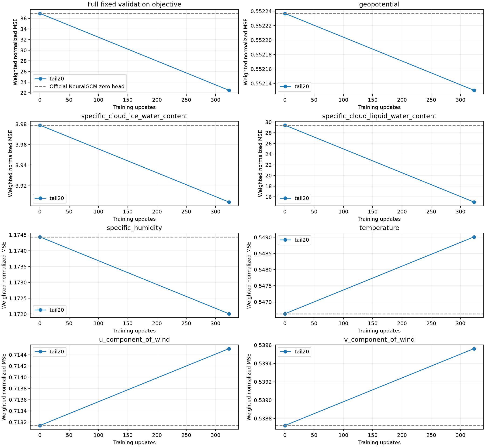

# Dense validation snapshot: update 323

The first complete checkpoint evaluation covers all 15 fixed 2022 validation segments (60 chunks), using the original tail20 inputs. The total weighted normalized loss decreases from **36.930139** for the official pretrained NeuralGCM zero head to **22.456985** at update 323, a **39.1906%** reduction.

This is not broad improvement across weather variables. Cloud liquid water accounts for **99.4966% of the total loss reduction**. Before training it accounts for **79.6802% of the total objective**, despite its 0.05 field coefficient. Temperature and both wind components are slightly worse. The experiment keeps its declared objective unchanged while reaching 2,000 updates.

| Variable | Zero-head loss contribution | Update 323 contribution | Reduction (%) |
| --- | ---: | ---: | ---: |
| temperature | 0.54663175 | 0.54901209 | -0.4355 |
| geopotential | 0.55223687 | 0.55213047 | +0.0193 |
| u_component_of_wind | 0.71313939 | 0.71450946 | -0.1921 |
| v_component_of_wind | 0.53872269 | 0.53956058 | -0.1555 |
| specific_humidity | 1.17443441 | 1.17200986 | +0.2064 |
| specific_cloud_ice_water_content | 3.97897740 | 3.90406650 | +1.8827 |
| specific_cloud_liquid_water_content | 29.42599666 | 15.02569615 | +48.9373 |

Positive reduction means lower loss. These are normalized, area/pressure/field-weighted MSE contributions, not raw physical RMSE. No confidence interval is claimed for these small per-variable changes.

Only the zero-head reference and one trained checkpoint are available in this snapshot. The connecting lines do not establish a monotonic learning curve. Update 500 and later saved checkpoints have been discovered automatically and are queued for the same evaluation. Both training arms continue independently.

Provenance and aggregate results are in [protocol.json](protocol.json) and [summary.json](summary.json). Checkpoint SHA256 and per-step losses are retained in the aggregate results.
