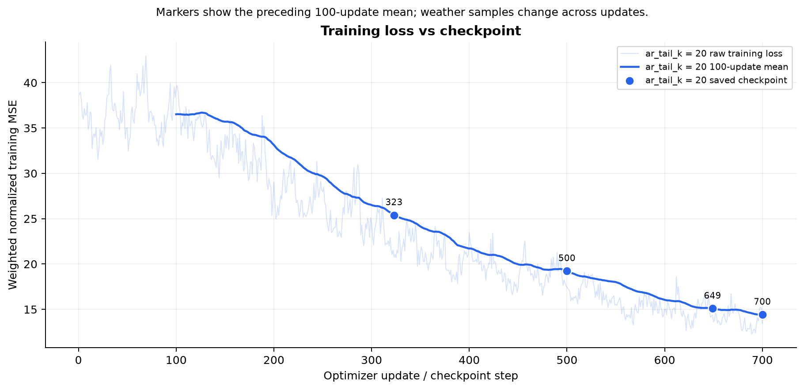
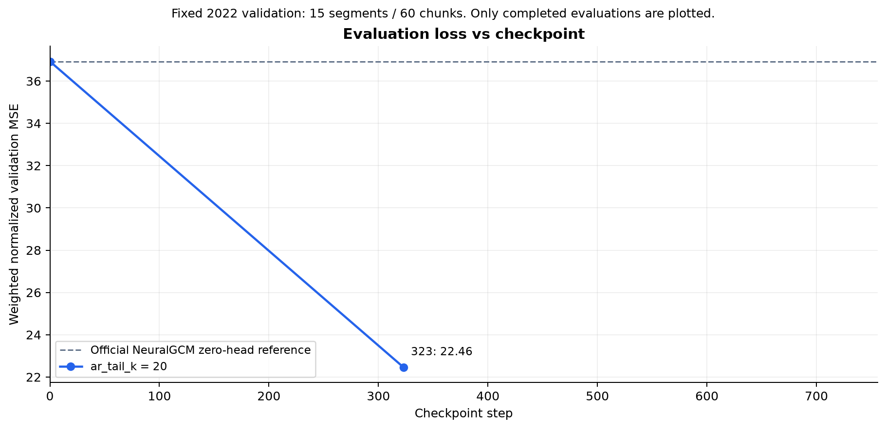
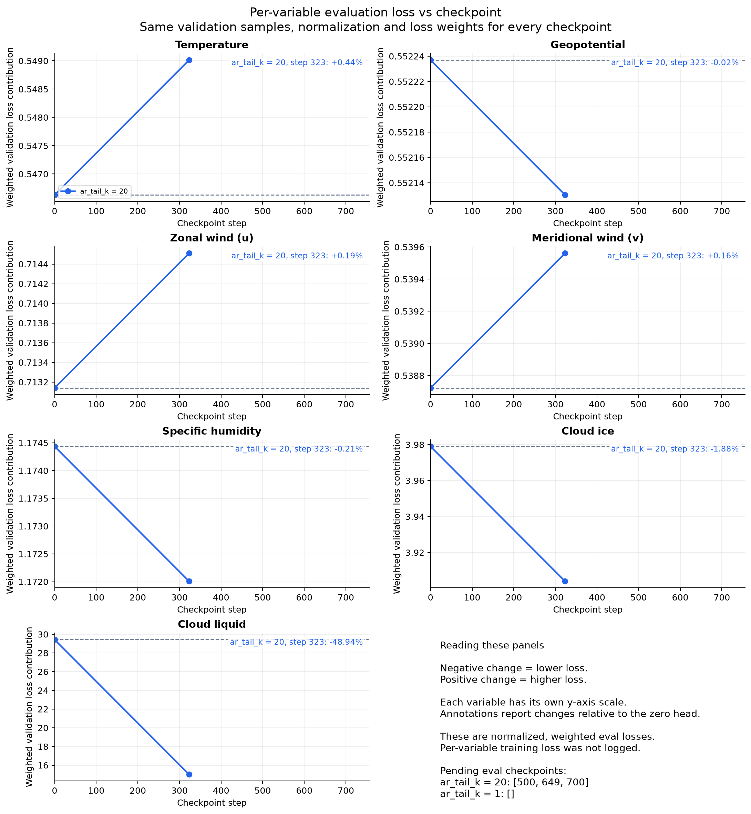

# Loss versus checkpoint

Training traces extend through the latest saved checkpoint. Checkpoint markers show the mean of the preceding 100 training updates; the CSV also contains the single-update loss. Training samples vary with update, so that curve is not a fixed validation comparison.

Evaluation uses the same complete 2022 validation set (15 segments, 60 chunks) and common tail20 inputs. Only completed evaluations appear. Step zero is the official pretrained NeuralGCM zero-head reference. Lines connect observations and do not establish unmeasured intermediate values or monotonic decay.

Per-variable curves are eval loss contributions, not raw physical RMSE. Per-variable training history is unavailable because it was not logged. Negative percentages in the panels mean lower loss. The side panel lists checkpoints awaiting evaluation.

## Training loss

## Evaluation loss

## Per-variable evaluation loss

Source values are in [train_checkpoint_losses.csv](train_checkpoint_losses.csv), [train_update_losses.csv](train_update_losses.csv), [eval_checkpoint_losses.csv](eval_checkpoint_losses.csv) and [plot-data.json](plot-data.json).
