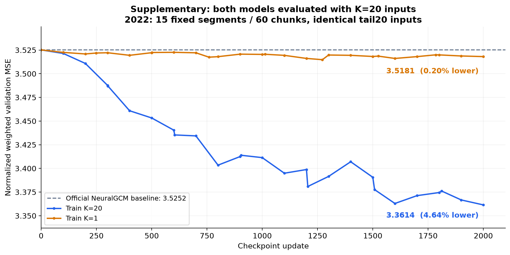
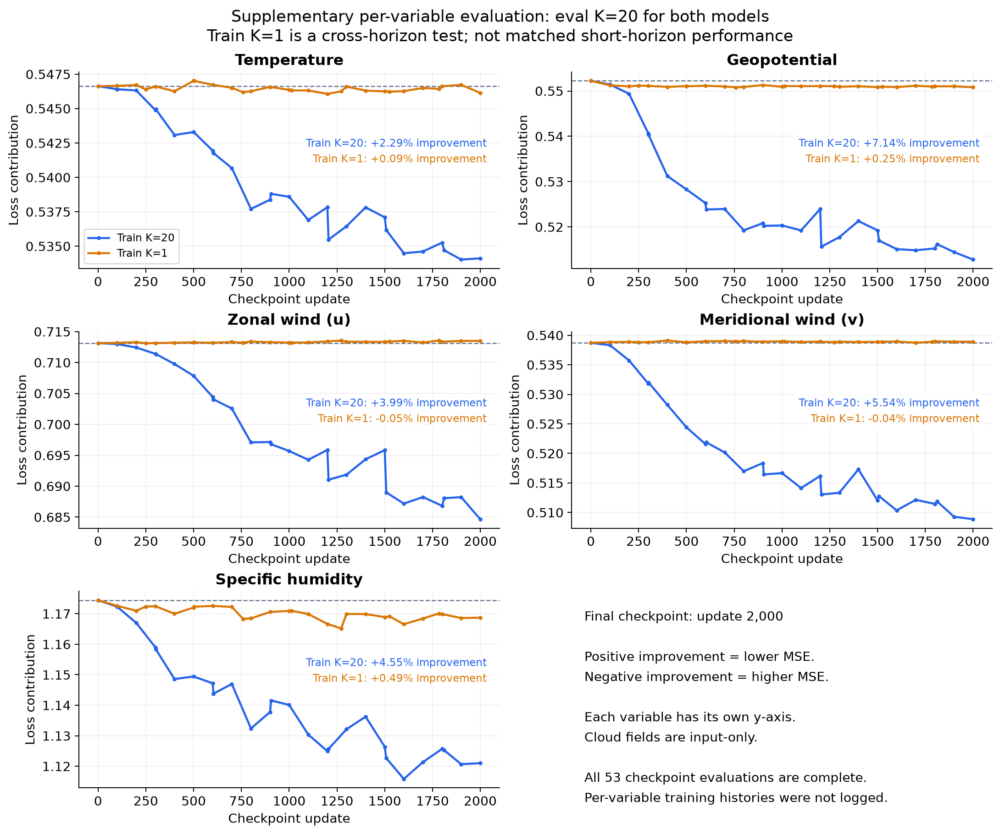
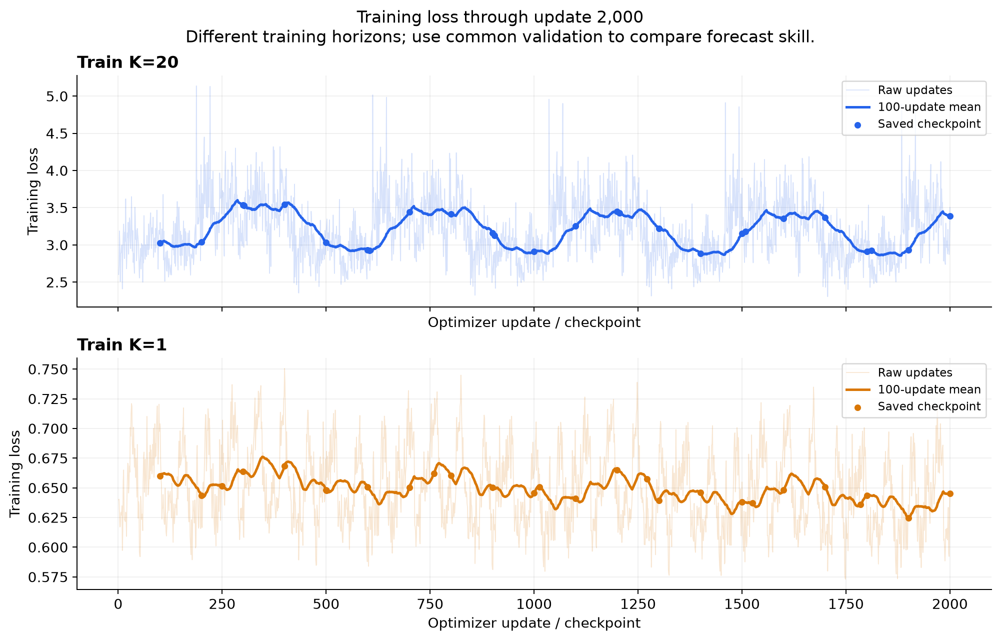
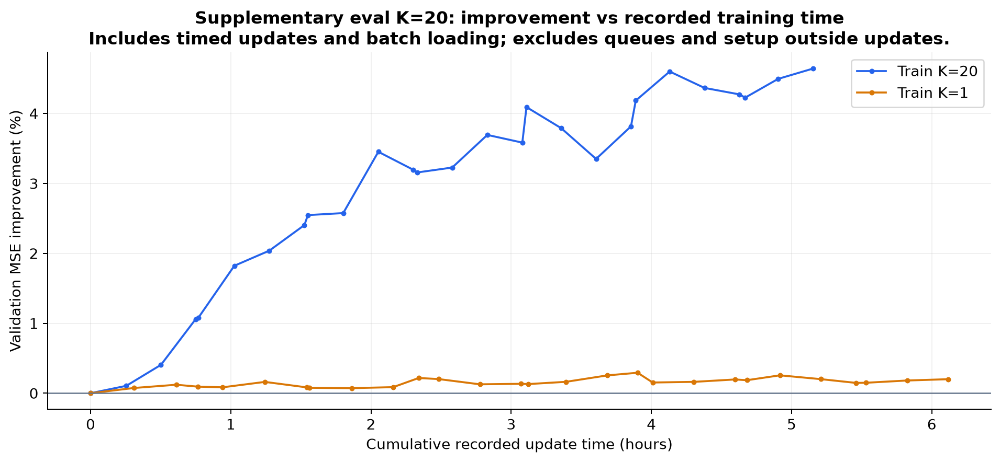
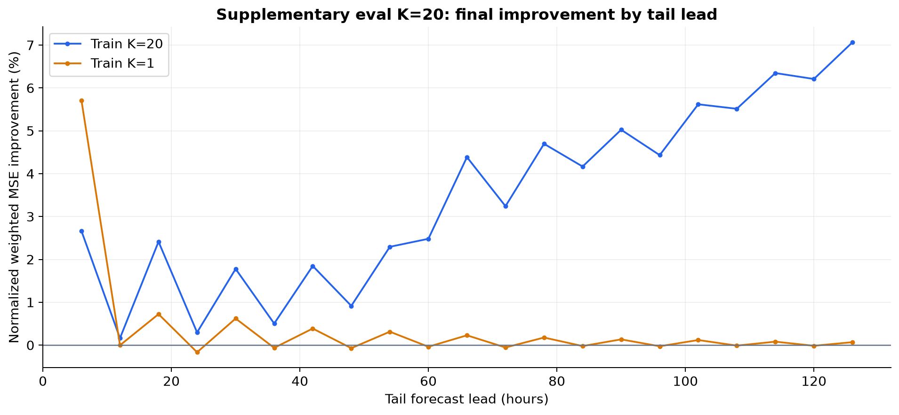

# Supplementary loss v2: common K20 evaluation

**This is cross-horizon evaluation for the model trained with K=1. It is not the primary training-matched comparison.** See the [primary matched K1 and K20 report](../v2_matched_20261106/README.md). The K1 result of 0.20% here does not describe its short-horizon performance.

**Both independent runs finished 2,000 updates and every saved checkpoint common-K20 evaluation.** K=20 has 26 complete evaluations; K=1 has 27. Matched K1 evaluation is tracked separately in the primary report.

## Common validation results

The fixed 2022 validation set contains 15 segments / 60 chunks. Both arms use the same tail20 native inputs, 50–1000 hPa targets, Gaussian latitude weights, pressure weights and train-only 6 h-difference normalization. Memory resets once per segment and carries across four chunks. Percentages below are reductions in normalized weighted MSE relative to the official pretrained NeuralGCM baseline.

| Quantity | Baseline | K=1 loss | K=1 improvement | K=20 loss | K=20 improvement |
|---|---:|---:|---:|---:|---:|
| Total | 3.525165 | 3.518109 | +0.20% | 3.361450 | +4.64% |
| Temperature | 0.546632 | 0.546135 | +0.09% | 0.534120 | +2.29% |
| Geopotential | 0.552237 | 0.550837 | +0.25% | 0.512812 | +7.14% |
| Zonal wind (u) | 0.713139 | 0.713509 | -0.05% | 0.684651 | +3.99% |
| Meridional wind (v) | 0.538723 | 0.538914 | -0.04% | 0.508856 | +5.54% |
| Specific humidity | 1.174434 | 1.168713 | +0.49% | 1.121010 | +4.55% |

The final K=20 checkpoint improves all five variables. K=1 improves T, Z and q slightly, while both wind terms worsen slightly. The final K=20 common-validation loss is 4.45% lower than K=1.

These are endpoint results, not validation-selected best checkpoints. Curves are not strictly monotonic. This is a single-seed 2022 monitoring comparison, not a held-out 2023 result. Changing ar_tail_k changes both training horizon and teacher forcing, so this does not isolate the causal contribution of Mamba memory. Per-variable values are weighted normalized losses, not physical-unit RMSE.

## Evaluation loss vs checkpoint

## Per-variable evaluation loss

## Training loss vs checkpoint

The two training losses have different forecast horizons and should not be ranked directly. Markers show the preceding 100-update mean at saved checkpoints.

## Improvement vs recorded training time

Recorded update seconds exclude queueing and setup outside the timed update loop. This is not total wall-clock completion time.

## Final improvement by tail lead

## Files and exact paths

GitHub branch: `residualmamba_NGCM_rebuild_20261104`.

Repository directory: `experimental/residualmamba_NGCM/results/v2_comparison_20261106/`.

Published local directory: `/scratch/gpfs/MENGDIW/sh4809/weatherforecast/Weather_Global_rebuild/experimental/residualmamba_NGCM/results/v2_comparison_20261106`.

- Train K=20 original plots: `/scratch/gpfs/MENGDIW/sh4809/weatherforecast/Weather_Global_rebuild/artifacts/v2_2k_20261105/eval/separate_plots`
- Train K=1 original plots: `/scratch/gpfs/MENGDIW/sh4809/weatherforecast/Weather_Global_rebuild/artifacts/v2_tail1_2k_20261105/eval/separate_plots`

[All eval values](eval_checkpoint_losses.csv) · [Final metrics](final_metrics.csv) · [Training values](train_update_losses.csv) · [Lead metrics](final_lead_metrics.csv) · [Source receipts and plot data](plot-data.json).
