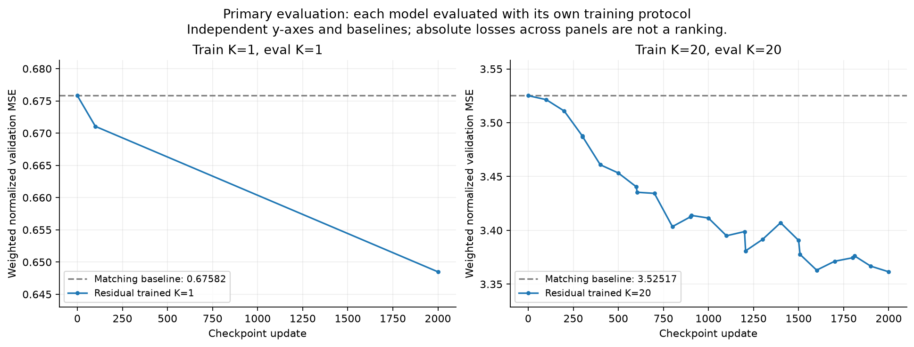
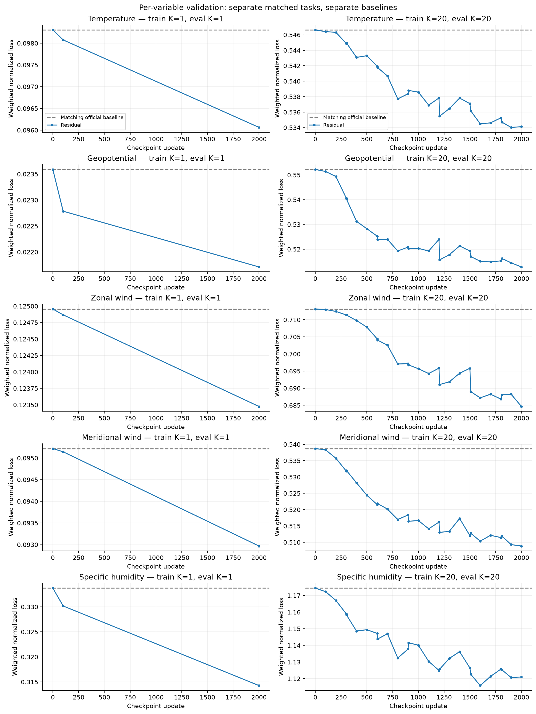

# Primary loss v2 results: training-matched evaluation

**Status: K=1: 2/27 matched evaluations complete; K=20: 26/26 complete.**

The primary analysis evaluates each model using the same input/origin/forecast-horizon protocol as its own training run. K=1 has its own official pretrained NeuralGCM baseline. K=20 has its own baseline. Absolute losses across these different tasks must not be ranked.

The previous [common-tail20 comparison](../v2_comparison_20261106/README.md) is supplementary cross-horizon evaluation. Its K=1 improvement of 0.20% describes train K=1 / eval K=20, not matched K=1 performance.

| Training K | Evaluation K | Update-2000 loss | Matching baseline | Improvement |
|---|---|---:|---:|---:|
| 1 | 1 | 0.648487 | 0.675817 | +4.04% |
| 20 | 20 | 3.361450 | 3.525165 | +4.64% |

## Final per-variable results

### Train K=1, eval K=1

| Variable | Residual loss | Matching baseline | Improvement |
|---|---:|---:|---:|
| Temperature | 0.096064 | 0.098306 | +2.28% |
| Geopotential | 0.021712 | 0.023588 | +7.95% |
| Zonal wind | 0.123475 | 0.124956 | +1.19% |
| Meridional wind | 0.092968 | 0.095219 | +2.36% |
| Specific humidity | 0.314268 | 0.333748 | +5.84% |

### Train K=20, eval K=20

| Variable | Residual loss | Matching baseline | Improvement |
|---|---:|---:|---:|
| Temperature | 0.534120 | 0.546632 | +2.29% |
| Geopotential | 0.512812 | 0.552237 | +7.14% |
| Zonal wind | 0.684651 | 0.713139 | +3.99% |
| Meridional wind | 0.508856 | 0.538723 | +5.54% |
| Specific humidity | 1.121010 | 1.174434 | +4.55% |

## Matched evaluation curves

## Exact protocols

- Both use all 15 fixed 2022 validation segments / 60 chunks, train-only normalization, the five scored fields on 50–1000 hPa, Gaussian latitude weights and unchanged pressure weights. Memory resets at each segment and carries across four chunks.
- The reported total averages all 24 positions, exactly as the training objective does.
- K=1: 22 independent 6 h prefix predictions, then a tail at 6 h and 12 h. There are 23 six-hour targets and one twelve-hour target per chunk.
- K=20: 3 independent 6 h prefix predictions, then a tail at 6–126 h.
- For every prediction, the residual and its official pretrained NeuralGCM baseline use identical origins, target valid times and leads.
- K=20 results are reused because the existing K20 loader and evaluator already match its training protocol. K=1 is recomputed with the authenticated K1 cache and the original training loader.
- The new evaluator imports qualified code from each immutable training snapshot. It does not retrain either model or feed corrected weather fields back into NeuralGCM.
- Each new K1 job checks a real H200 forward pass and verifies baseline contributions against direct per-step loss computation before the full evaluation.
- These are single-seed monitoring results on 2022, not held-out 2023 skill or an isolated memory ablation.

## Training losses

Training objectives have different horizons. The [training curves](../v2_comparison_20261106/train_loss_vs_checkpoint.png) remain in separate panels.

## Reproduction and paths

Generated report: `/scratch/gpfs/MENGDIW/sh4809/weatherforecast/Weather_Global_rebuild/experimental/residualmamba_NGCM/results/v2_matched_20261106`.
Raw K1 matched evaluation and submission receipts: `/scratch/gpfs/MENGDIW/sh4809/weatherforecast/Weather_Global_rebuild/artifacts/v2_matched_eval_20261106`.

Worker: [`matched_v2_eval.py`](../../matched_v2_eval.py). Controller: [`watch_matched_v2_eval.py`](../../watch_matched_v2_eval.py). Plot/report generator: [`report_matched_v2.py`](../../report_matched_v2.py).

[All plotted values](matched_eval_losses.csv) · [Provenance and plot data](plot-data.json).
